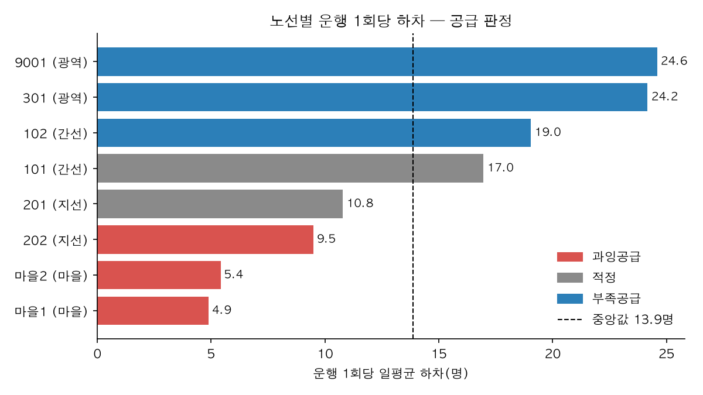
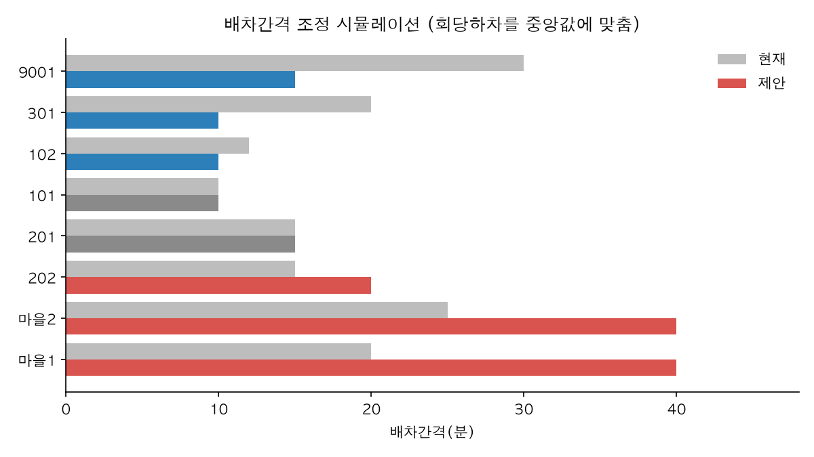

# 노선별 운영 효율 분석

- 데이터: 2026-10-01~07(7일), 8개 노선, 05~23시 운행(하루 1,080분)
- 스크립트: `analysis/route_efficiency.py` (`.venv/bin/python analysis/route_efficiency.py`)
- 일 운행횟수 = 운행시간 ÷ 배차간격 (한 방향 추정치). 효율의 기준은 **운행 1회당 하차**로 잡음

## 핵심 수치

| 노선 | 유형 | 배차(분) | 대수 | 일평균 하차 | 대당 하차 | 회당 하차 | 대당 운행횟수 | 판정 |
|---|---|---:|---:|---:|---:|---:|---:|---|
| 9001 | 광역 | 30 | 14 | 885 | 63 | **24.6** | **2.6** | 부족공급 |
| 301 | 광역 | 20 | 4 | 1,305 | **326** | 24.2 | 13.5 | 부족공급 |
| 102 | 간선 | 12 | 8 | 1,714 | 214 | 19.0 | 11.2 | 부족공급 |
| 101 | 간선 | 10 | 12 | 1,832 | 153 | 17.0 | 9.0 | 적정 |
| 201 | 지선 | 15 | 13 | 776 | 60 | 10.8 | 5.5 | 적정 |
| 202 | 지선 | 15 | 11 | 683 | 62 | 9.5 | 6.5 | 과잉공급 |
| 마을2 | 마을 | 25 | 12 | 234 | 20 | 5.4 | 3.6 | 과잉공급 |
| 마을1 | 마을 | 20 | 12 | 264 | 22 | **4.9** | 4.5 | 과잉공급 |

판정 기준: 회당 하차가 중앙값(13.9명)의 0.7배 미만이면 과잉, 1.3배 초과면 부족.

노선유형별 회당 하차는 광역 24.3 > 간선 17.9 > 지선 10.1 > 마을 5.1명이고, 대당 하차는 간선 177 > 광역 122 > 지선 61 > 마을 21명이다.

## 발견

1. **마을버스가 가장 비효율적이다.** 마을1·마을2는 회당 하차가 5명 안팎으로 중앙값의 0.4배다. 두 노선이 차량 24대(전체 86대의 28%)를 쓰지만 하차는 전체의 5%(498명/일)에 그친다.
2. **광역 2개 노선은 차내 혼잡이 우려된다.** 회당 하차가 24명대로 마을버스의 5배다. 301은 4대로 하루 1,305명을 실어 나르며 대당 하차(326명)와 대당 운행횟수(13.5회)가 모두 최고다.
3. **9001은 차량이 남는데 배차는 성기다.** 14대를 보유하면서 배차간격이 30분이라 대당 운행횟수가 2.6회(중앙값 6.0회)뿐이다. 차량을 더 사지 않고도 배차를 줄일 여지가 크다.
4. **간선 102도 빠듯하다.** 회당 19.0명으로 같은 간선인 101(17.0명)보다 높은데 배차는 더 길다(12분 vs 10분).

## 배차간격 조정 시뮬레이션

회당 하차를 중앙값 13.9명에 맞추도록 배차간격을 다시 계산했다(5분 단위, 5~40분 범위).

| 노선 | 배차(분) 현재→제안 | 일 운행횟수 | 회당 하차 | 필요 대수 |
|---|---|---|---|---|
| 9001 | 30 → 15 | 36 → 72 | 24.6 → 12.3 | 가동도 중앙값(6회) 기준 12대, 보유 14대로 충분 |
| 301 | 20 → 10 | 54 → 108 | 24.2 → 12.1 | 현 가동도 유지 시 8대 (+4) |
| 102 | 12 → 10 | 90 → 108 | 19.0 → 15.9 | 현 가동도 유지 시 10대 (+2) |
| 202 | 15 → 20 | 72 → 54 | 9.5 → 12.6 | 8대 (−3) |
| 마을1 | 20 → 40 | 54 → 27 | 4.9 → 9.8 | 4~6대 (−6 이상) |
| 마을2 | 25 → 40 | 43 → 27 | 5.4 → 8.7 | 4~8대 (−4 이상) |

마을버스 2개 노선과 202에서 13대 이상이 남는다. 301(+4)과 102(+2)에 필요한 6대를 채우고도 여유가 있어, 총 운행대수를 늘리지 않고 재배치만으로 가능하다.

## 운영 제언

1. **9001 배차를 30분에서 15분으로 줄인다.** 보유 차량으로 가능해 비용 부담은 가장 작고 효과는 가장 크다.
2. **마을1·마을2 배차를 40분으로 늘리고**, 남는 차량 가운데 6대를 **301(+4)과 102(+2)**로 옮긴다.
3. 202는 배차를 15분에서 20분으로 늘린다. 다만 같은 지선인 201과 겹치는 구간의 수요를 먼저 확인한다.
4. 마을버스는 40분 배차로 늘려도 회당 하차가 9명 안팎에 머문다. 수요응답형(DRT) 전환이나 노선 통합을 검토할 만하다.

## 한계

- 하차 데이터만 있어 승차·재차인원을 알 수 없다. 혼잡도는 회당 하차로 간접 추정했다.
- 운행횟수는 첫차~막차 고정 배차를 가정한 한 방향 추정치다. 시간대별 차등 배차는 반영하지 않았다.
- 노선 길이·회전시간 자료가 없어 필요 대수는 대당 운행횟수(가동도) 기준으로 어림했다.
- 더미 데이터 7일치이므로 수치는 방법론 예시로 보아야 한다.
